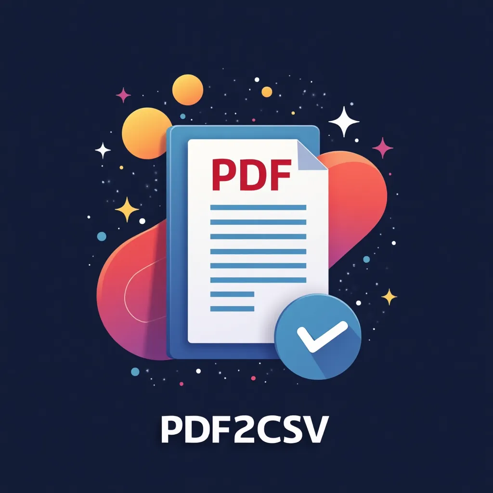

# PDF to CSV Converter
<p>
<a href="https://pypi.org/project/pdf2csv" target="_blank">
    
</a>
<a href="https://pypi.org/project/pdf2csv" target="_blank">
    
</a>
<a href="https://codecov.io/gh/ghodsizadeh/pdf2csv" target="_blank">
    
</a>
<a>
    
</a>
    
    
    <!-- downloads -->
    


</p>




This project extracts tables from PDF files and saves them as CSV or XLSX. It reads the vector drawing in the PDF: ruling lines become the grid, and each cell is rebuilt from the glyphs inside it. There is no layout model, no OCR, and no download at runtime.

Python 3.12 or newer is required.

## How It Works

1. **PDF Input**: Provide the path to a born-digital PDF. By default the file must be an unencrypted `.pdf`, at most 50 MiB, and at most 100 pages.
2. **Table Extraction**: Connected ruled lines are snapped into separate grids. Text alignment finds borderless tables outside those grids, including on mixed pages.
3. **DataFrame Conversion**: The first row of each table becomes the column names. A column becomes numeric only when every non-empty cell is a number.
4. **Right-to-left text**: Directional runs reconstruct common Arabic and Hebrew layouts while preserving Latin phrases and numbers. `--rtl` prefers RTL interpretation; Latin text at both ends still anchors an LTR paragraph. Columns stay in left-to-right page order.
5. **CSV/XLSX Output**: Each table is saved in page order, then top-to-bottom and left-to-right within the page. Files are named `<pdf-stem>-table-1.csv` (or `.xlsx`), and so on. Tables on different pages are not automatically stitched together.

Scanned pages and other image-only PDFs are not supported. Those files have no text glyphs to read. See [migration notes and limitations](docs/migration-0.3.md) before upgrading from the Docling-based version.

## Installation

Requires Python 3.12+.

```sh
pip install pdf2csv
```

The offline rewrite is being prepared as `0.3.0rc1`. Once published, opt into
the candidate explicitly:

```sh
pip install pdf2csv==0.3.0rc1
```

Until then, install the checkout instead:

```sh
pip install .
# Or use the locked development environment:
uv sync --locked
```

## AI agent skills (Library Skills)

pdf2csv bundles version-matched instructions for coding agents using
[Library Skills](https://library-skills.io/). The skill covers the CLI, Python
API, safe CSV/XLSX exports, RTL text, and extraction limitations. It ships in
the Python package; installing pdf2csv does **not** automatically configure your
agent or run an installer.

In your consuming project's directory, add pdf2csv to its dependencies and install
it into the project's environment before discovering skills:

```sh
uv add pdf2csv
uvx library-skills
```

Select the **pdf2csv** skill and `.agents/skills` when prompted. For Claude Code,
select `.claude/skills` instead, or run `uvx library-skills --claude`.
Library Skills normally links to the installed package so instructions stay in
sync with upgrades. Use `--copy` if symlinks are unavailable; refresh copied
skills after upgrading. Re-run the command to repair links after environment changes.

For pip-based projects, declare pdf2csv in `pyproject.toml` and install it in a
project-local `.venv`; then run `uvx library-skills` (or
`pip install library-skills` followed by `library-skills`).
Library Skills is an optional setup tool, not a pdf2csv runtime dependency.
An isolated `uvx pdf2csv` invocation alone does not install pdf2csv in your
project's environment for skill discovery.

**Before this change is published**, install this checkout into your consuming
project's environment instead of expecting the skill in an older PyPI release.
You can inspect discovery without installing links with
`uvx library-skills scan --json`.

**For agents:** load the installed `pdf2csv/SKILL.md` from your configured skills
directory before writing extraction code. If your agent does not discover those
directories, explicitly provide the bundled file at
`pdf2csv/.agents/skills/pdf2csv/SKILL.md` inside the installed package.
Do not assume an older pdf2csv release has the same API or bundled skill.

**For maintainers:** edit
[`pdf2csv/.agents/skills/pdf2csv/SKILL.md`](pdf2csv/.agents/skills/pdf2csv/SKILL.md)
alongside API/CLI changes. The file is included in wheels and source distributions;
keep examples accurate for the version being released.

## CLI Usage

```sh
pdf2csv convert <pdf_path> --output-dir <output_dir> --output-format <csv|xlsx> --rtl --verbose
```

Example:

```sh
pdf2csv convert example.pdf --output-dir ./output --output-format xlsx --rtl --verbose
```

`convert-cli` remains available as an alias for existing scripts. Output files are
protected by default; use `--overwrite` to replace them. See the [CLI guide](docs/cli.md)
for input limits and `--fail-on-empty`.

## With uvx

```sh
uvx pdf2csv convert <pdf_path> --output-dir <output_dir> --output-format <csv|xlsx> --rtl --verbose
```

Example:

```sh
uvx pdf2csv convert example.pdf --output-dir ./output --output-format xlsx --rtl --verbose
```

## Python Usage

```python
from pdf2csv.converter import convert

pdf_path = "example.pdf"
output_dir = "./output"
rtl = True
output_format = "xlsx"

dfs = convert(pdf_path, output_dir=output_dir, rtl=rtl, output_format=output_format, index=False)
for df in dfs:
    print(df)
```

See the [structured Python API](docs/api.md) for raw rows, page and table metadata,
page selection, cropping, headerless tables, and numeric/dtype control.

## English and Farsi examples

The repository includes [17 generated example PDFs](examples/README.md), including
shaped Farsi with embedded fonts, mixed digit scripts, multiple tables and pages:

```sh
uv run --locked pdf2csv convert examples/english_pages.pdf -o /tmp/pdf2csv-english
uv run --locked pdf2csv convert examples/farsi_ruled.pdf -o /tmp/pdf2csv-farsi -f xlsx
```

Arabic/Farsi detection is automatic; `--no-rtl` does not turn it off. `--rtl`
prefers RTL interpretation when a cell mixes mostly Latin text with RTL text.
Latin text at both ends retains LTR paragraph order. Columns always stay in
physical left-to-right page order. Visual glyph positions cannot recover every
original bidi ordering; the [mixed-direction example](examples/README.md) records
a numeric/Latin ambiguity explicitly.

## Development and verification

```sh
uv sync --locked
uv run --locked pytest
uv run --locked ruff check .
uv run --locked ruff format --check .
uv run --locked --group examples python examples/generate.py
```

CI tests Python 3.12–3.14, minimum/latest dependency installations and reproducible
PDF generation. See [the measured Docling comparison](benchmarks/README.md) for
methodology, raw results and limitations; the small regression corpus is not a
general-purpose PDF accuracy guarantee.

The CLI exits with `0` on success (including no tables by default), `1` on
conversion/write errors or empty results with `--fail-on-empty`, and `2` for
invalid command-line arguments.

See the [release notes](CHANGELOG.md) for compatibility changes and the
[maintainer release guide](docs/releasing.md) for building, tagging and publishing.
